# Архитектура сервера UniCore

Целевое устройство `apps/api` — сервера на NestJS 12, который заменяет Supabase. Порядок работ, задачи и проверки — в [плане перехода](backend-migration.md); этот документ описывает, как сервер устроен и почему. Если решение меняется по ходу работы, правится и этот файл, и план.

Источник правил предметной области — финальные версии функций в [supabase/migrations/](../supabase/migrations/) и сценарии [tests/database.test.ts](../tests/database.test.ts). Диаграммы — Mermaid: GitHub показывает их сразу, VS Code — с расширением для Mermaid.

## 1. Границы системы

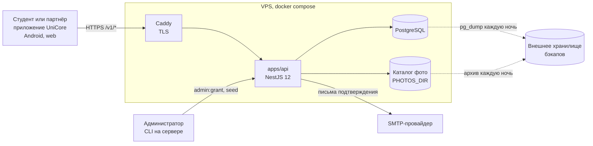

Принципы:

- **Модульный монолит.** Один процесс Nest, модули по функциям. Микросервисы и очереди не нужны: 14 таблиц и около 17 адресов.
- **Сервер — единственный источник правды.** Клиент не пишет в базу напрямую; все правила, которые раньше держали RLS и функции PL/pgSQL, живут в сервисах.
- **Процесс без состояния.** Всё хранится в PostgreSQL и каталоге фото, поэтому перезапуск и обновление безопасны.
- **Опрос вместо push.** Приложение, как и сейчас, перезагружает снимок раз в 15 секунд и после каждого изменения. WebSocket — после перехода (раздел 12).

## 2. Пакеты монорепозитория

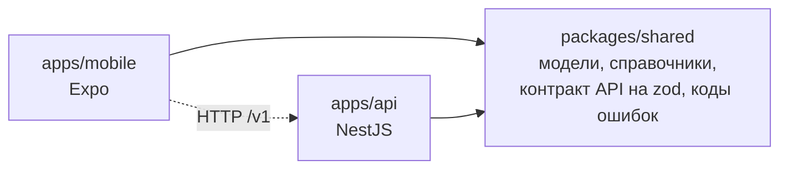

`packages/shared` не зависит ни от Expo и React Native, ни от Nest и Node API — только TypeScript и zod. Контракт ложится рядом с уже перенесёнными файлами:

```text
packages/shared/src/
  models.ts catalog.ts invite.ts errors.ts   уже есть
  api/
    auth.ts        sign-in, sign-up, refresh, ответ с токенами
    profile.ts     PATCH /v1/profile
    activities.ts  создание события, запись, закладки
    rooms.ts       комната, сообщение, помощник
    photos.ts      ответ загрузки
    admin.ts       промокод партнёра
    snapshot.ts    Snapshot, Activity, Profile, EventRoom — z.infer совпадает с models.ts
    errors.ts      тело ошибки и HTTP-статус каждого кода
```

Сервер проверяет этими схемами вход (`@Body({ schema })`), приложение — разбирает ими ответы в `httpRepository`. Изменение контракта — один коммит, который правит обе стороны.

## 3. Модули сервера

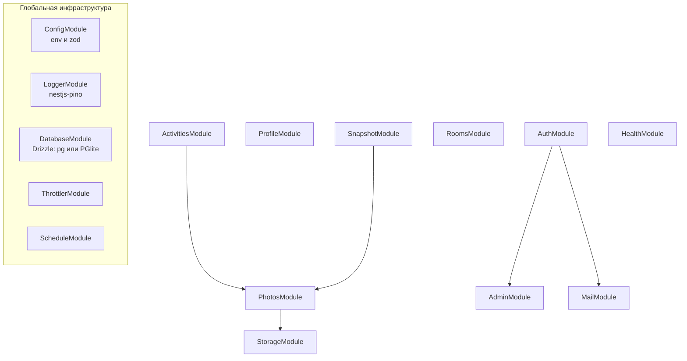

`AppModule` импортирует все модули; стрелки — зависимости между функциональными модулями. Циклов нет: проверка прав администратора — отдельный guard в `AdminModule`, а `AuthModule` берёт у него только `PartnerCodesService`.

| Модуль             | Отвечает за                                                            | Адреса                                                                                      | Пишет в таблицы                                                         |
| ------------------ | ---------------------------------------------------------------------- | ------------------------------------------------------------------------------------------- | ----------------------------------------------------------------------- |
| `AuthModule`       | регистрация, вход, токены, подтверждение почты, глобальный `AuthGuard` | `/v1/auth/*`                                                                                | `users`, `profiles` (при регистрации), `refresh_tokens`, `email_tokens` |
| `ProfileModule`    | свой профиль и тема                                                    | `PATCH /v1/profile`                                                                         | `profiles`                                                              |
| `ActivitiesModule` | создание событий, запись и отмена, закладки                            | `POST /v1/activities`, `PUT …/membership`, `PUT …/saved`                                    | `activities`, `participants`, `saved`, `photos` (привязка)              |
| `RoomsModule`      | комната события: состав, сообщения, помощники, исключение              | `GET …/room`, `POST …/messages`, `PUT …/members/:userId/cohost`, `DELETE …/members/:userId` | `messages`, `exclusions`, `participants`, `saved`                       |
| `PhotosModule`     | загрузка, подписанные ссылки, раздача файлов, уборка                   | `POST /v1/photos`, `GET /v1/files/:id`                                                      | `photos`, файлы                                                         |
| `SnapshotModule`   | сборка снимка, только чтение                                           | `GET /v1/snapshot`                                                                          | —                                                                       |
| `AdminModule`      | промокоды партнёров, `AdminGuard`                                      | `POST /v1/admin/partner-codes`                                                              | `admins`, `partner_codes`                                               |
| `HealthModule`     | проверка живости сервера и базы                                        | `GET /v1/health`                                                                            | —                                                                       |
| `MailModule`       | письма: в консоль при разработке, SMTP в проде                         | —                                                                                           | —                                                                       |
| `StorageModule`    | `put` / `get` / `delete` файлов: диск или память в тестах              | —                                                                                           | —                                                                       |

Таблицы `organizations` и `groups` пишет только сидер (этап 6), адресов для них нет.

**Правило владения:** писать в таблицу может только модуль из последней колонки. Читать чужие таблицы через Drizzle можно — так работает снимок, который собирает данные всех модулей одним набором запросов.

### Слои внутри модуля

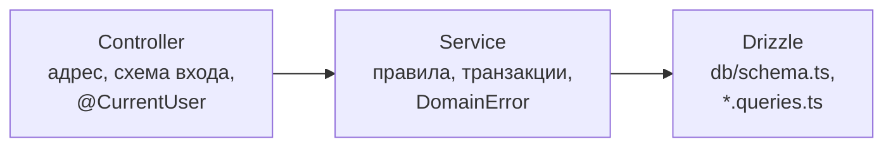

- Контроллер только связывает HTTP с сервисом: читает проверенный вход и текущего пользователя, вызывает один метод сервиса.
- Сервис не знает об HTTP: не бросает `HttpException`, а бросает `DomainError('UNICORE_FULL')`. Поэтому те же сервисы вызывают CLI-команды и сидер.
- Отдельного слоя репозиториев нет: запросы Drizzle и так типизированы. Большие запросы на чтение лежат рядом с сервисом в `*.queries.ts`.
- Транзакция открывается в сервисе. Вспомогательные функции принимают `tx`, чтобы шаги одного сценария шли в одной транзакции.

```ts
async setJoined(userId: string, activityId: string, joined: boolean) {
  await this.db.transaction(async (tx) => {
    const [activity] = await tx
      .select()
      .from(activities)
      .where(eq(activities.id, activityId))
      .for('update');
    if (!activity || (await isExcluded(tx, activityId, userId))) {
      throw new DomainError('UNICORE_NOT_FOUND');
    }
    // организатор, партнёр, начавшееся событие, свободные места — раздел 7.1
  });
}
```

## 4. Путь запроса

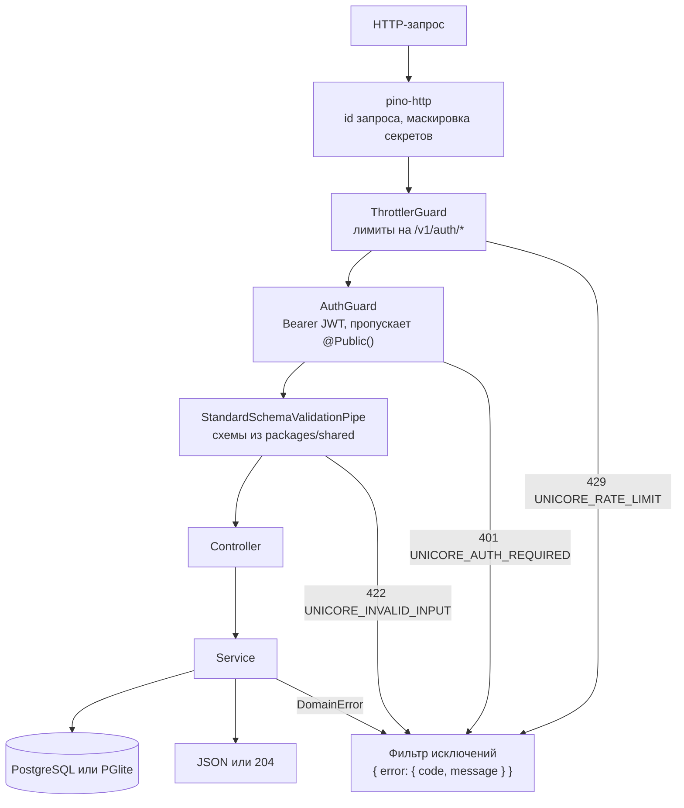

Все ошибки выходят через один глобальный фильтр в формате `{ "error": { "code": "UNICORE_FULL", "message": "…" } }`:

| Откуда                         | Код                      | HTTP                            |
| ------------------------------ | ------------------------ | ------------------------------- |
| `DomainError` из сервиса       | код ошибки               | по таблице из `packages/shared` |
| схема входа не прошла          | `UNICORE_INVALID_INPUT`  | 422                             |
| нет или неверный токен доступа | `UNICORE_AUTH_REQUIRED`  | 401                             |
| лимит частоты                  | `UNICORE_RATE_LIMIT`     | 429                             |
| неизвестный адрес              | `UNICORE_NOT_FOUND`      | 404                             |
| файл больше лимита multer      | `UNICORE_FILE_TOO_LARGE` | 413                             |
| любая другая ошибка            | `UNICORE_INTERNAL`       | 500, стек только в логе         |

Полный список кодов — в разделе «Контракт API» [плана](backend-migration.md#контракт-api).

## 5. Авторизация

### Токены

| Токен             | Формат                                      | Срок     | Где хранится                                                  |
| ----------------- | ------------------------------------------- | -------- | ------------------------------------------------------------- |
| доступа           | JWT HS256 (`jose`), `sub` — id пользователя | 15 минут | только у клиента                                              |
| обновления        | 32 случайных байта, base64url               | 30 дней  | у клиента; в базе — sha256 и семья (одна семья — одна сессия) |
| ссылка из письма  | 32 случайных байта                          | 24 часа  | в базе — sha256                                               |
| промокод партнёра | 32 hex-символа                              | 7 дней   | в базе — sha256 от `lower(trim(code))`                        |

В токене доступа нет ролей: права администратора проверяются по таблице `admins` на каждом запросе к `/v1/admin/*`, поэтому `admin:revoke` действует сразу. Пароли — argon2id (`@node-rs/argon2`) не слабее минимума OWASP: 19 МиБ памяти, 2 прохода, 1 поток. Для несуществующей почты сервер всё равно проверяет пароль против заранее вычисленного хеша, чтобы время ответа не выдавало, есть ли аккаунт.

### Вход и обновление сессии

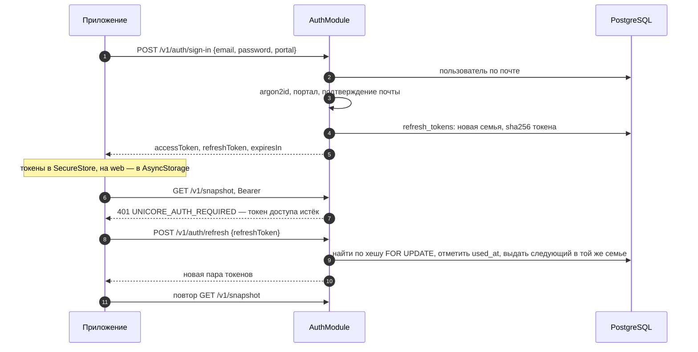

Клиент обновляет токен один раз на все запросы, получившие 401 одновременно (задача 7.2 плана).

### Жизнь токена обновления

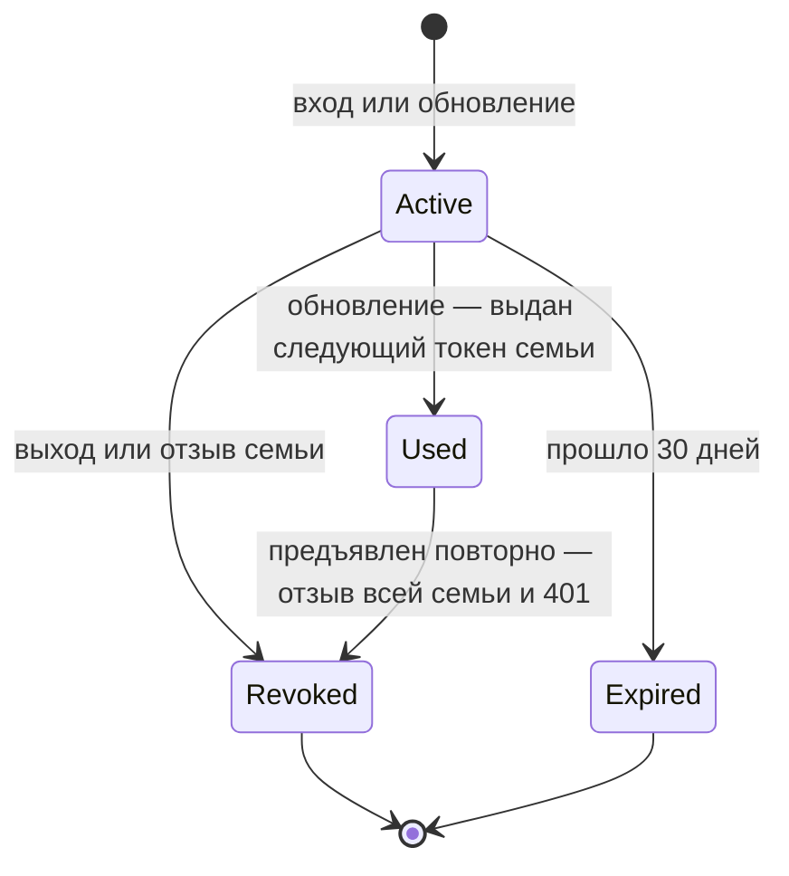

Повторное предъявление использованного токена значит, что его кто-то скопировал. Сервер отзывает всю семью, и обоим владельцам копий приходится входить заново.

### Регистрация и подтверждение почты

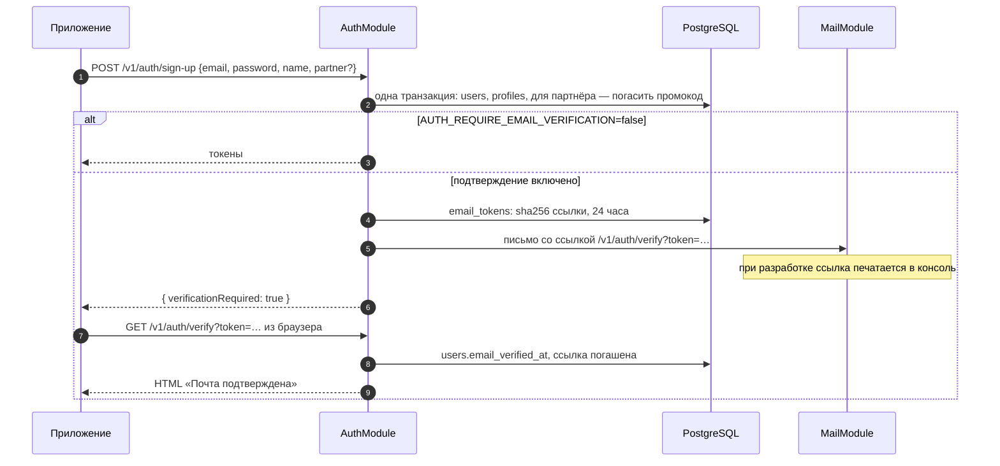

### Доступ к адресам

- Глобальный `AuthGuard` проверяет `Authorization: Bearer` на всех адресах и кладёт в запрос `{ userId }`.
- `@Public()` снимает проверку: `health`, `sign-in`, `sign-up`, `refresh`, `sign-out`, `resend-verification`, `verify` и `GET /v1/files/:id` — у последнего вместо токена подпись в ссылке.
- `@AdminOnly()` с `AdminGuard` закрывает `/v1/admin/*`.
- Тест 3.8 обходит маршруты из метаданных контроллеров, поэтому новый адрес без `@Public()` автоматически попадает под проверку.

## 6. База данных

### Схема

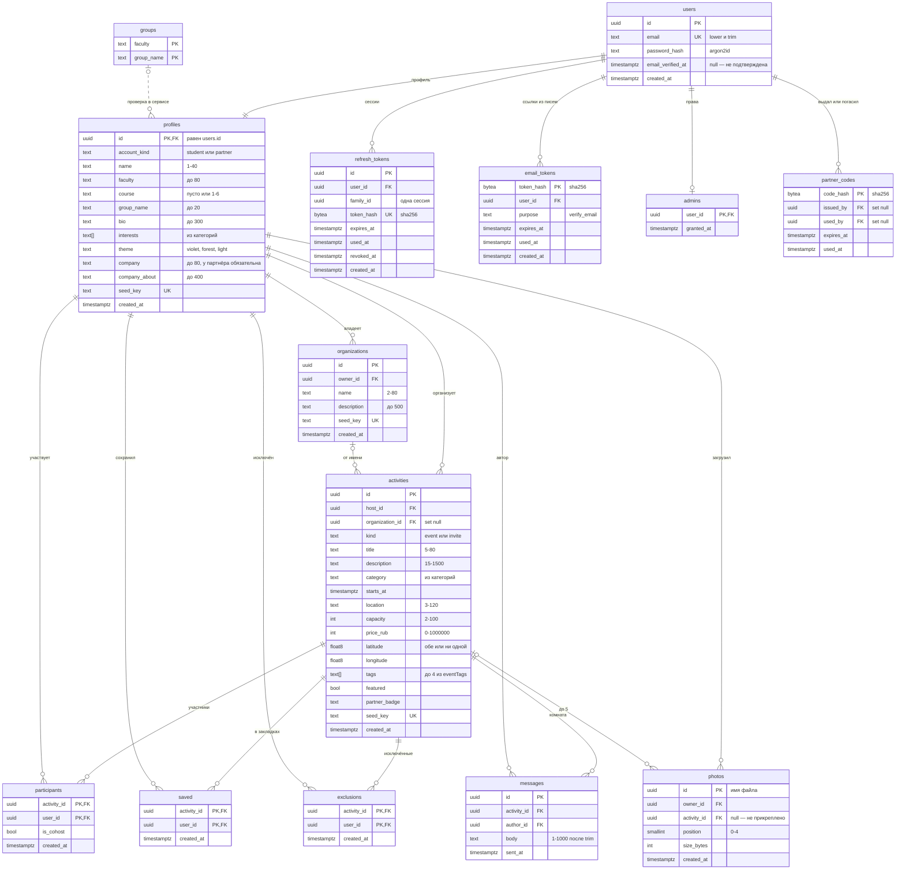

Внешние ключи на пользователя и событие — `on delete cascade`; `organization_id`, `issued_by` и `used_by` — `on delete set null`. Идентификаторы — `uuid` с `gen_random_uuid()`, время — `timestamptz`.

### Что проверяет база, а что сервис

База держит то, что видно по одной строке; сервис — правила, которым нужны другие строки или текущий пользователь.

| В базе: CHECK, UNIQUE, внешние ключи                                          | В сервисе                                                                     |
| ----------------------------------------------------------------------------- | ----------------------------------------------------------------------------- |
| длины и диапазоны полей, списки значений (`kind`, `category`, `theme`, бейдж) | дата события в будущем                                                        |
| координаты: обе пустые или обе в пределах                                     | теги — из `eventTags` и без повторов                                          |
| у партнёра есть компания, а институт, курс и группа пустые                    | пара институт–группа есть в `groups`, если изменилась (пустая пара допустима) |
| не больше одной записи и одной закладки на пару событие–пользователь          | свободные места под `SELECT … FOR UPDATE`                                     |
| не больше 5 фото: `position` 0–4 и `unique (activity_id, position)`           | фото принадлежат автору и ещё не прикреплены                                  |
| почта уникальна                                                               | доступ к комнате, права помощника, исключение, публикация от сообщества       |

Список тегов не дублируется в CHECK: источник — `eventTags` в `packages/shared`, и база не должна расходиться с ним при изменении справочника.

### Индексы

- `activities (created_at desc, id)` — порядок ленты; `(host_id)`, `(organization_id)`, `(starts_at)`.
- `participants (user_id)`, `saved (user_id)`, `exclusions (user_id)` — «мои» списки в снимке.
- `messages (activity_id, sent_at desc, id desc)` — последние 100 сообщений комнаты.
- `refresh_tokens (family_id)`, `refresh_tokens (user_id)`; `email_tokens (user_id, created_at desc)` — ограничение повторной отправки письма.
- `photos (activity_id)`; частичный `photos (created_at) where activity_id is null` — уборка неприкреплённых.

### Отличия от схемы Supabase

| Было в Supabase                                        | Стало                                                                                           |
| ------------------------------------------------------ | ----------------------------------------------------------------------------------------------- |
| `auth.users`, сессии Supabase Auth                     | свои `users`, `refresh_tokens`, `email_tokens`                                                  |
| префикс `unicore_` (база общая с другими приложениями) | без префикса                                                                                    |
| `activities.photo_paths text[]` и Storage              | таблица `photos`: владелец, привязка, порядок; файлы на диске                                   |
| триггеры: регистрация партнёра, проверка группы        | код сервиса в той же транзакции                                                                 |
| RLS и функции `security definer` с `auth.uid()`        | `AuthGuard` и сервисы; пользователь базы у сервера — владелец своей схемы, не суперпользователь |
| —                                                      | новые поля: `partner_codes.used_by`, `exclusions.created_at`, `admins.granted_at`               |

### Миграции

Схема описана в `apps/api/src/db/schema.ts`. `drizzle-kit generate` создаёт SQL-миграцию в `apps/api/drizzle/`, она коммитится. `db:migrate` применяет миграции при разработке, в проде — при старте контейнера (задача 8.4). Применённую миграцию не правят: изменения — новым файлом.

## 7. Ключевые сценарии

### 7.1 Запись на событие

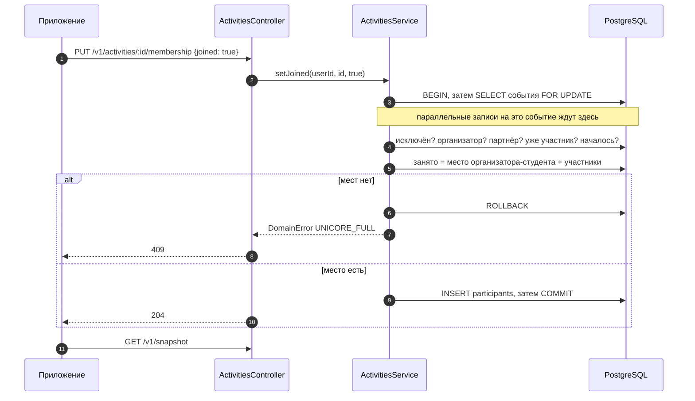

Повторная запись ничего не меняет — запрос задаёт желаемое состояние, поэтому его безопасно повторить после обрыва сети. Блокировка строки события делает проверку мест и вставку атомарными: тест 4.10 шлёт 20 параллельных записей на 4 свободных места и ждёт ровно 4 успеха.

### 7.2 Событие с фотографиями

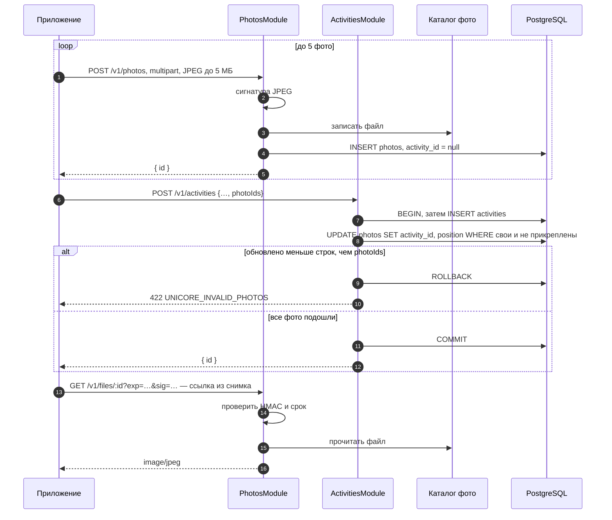

Если создание события не удалось, загруженные фото остаются неприкреплёнными, и через 24 часа их удаляет уборка (`@nestjs/schedule` и команда `photos:cleanup`). Сначала удаляется строка, потом файл: файл без строки безвреден, а строка без файла дала бы битую ссылку.

**Подписанная ссылка:** `sig = base64url(HMAC-SHA256(FILES_SECRET, id + "." + exp))`. `exp` округляется вверх до начала следующего часа плюс час. Поэтому снимки, которые приложение запрашивает каждые 15 секунд, в течение часа отдают одну и ту же ссылку, и картинка берётся из кеша, а не скачивается заново. Ответ файла — `Cache-Control: private, max-age=3600` и `X-Content-Type-Options: nosniff`.

### 7.3 Снимок

`GET /v1/snapshot` собирается в одной транзакции только для чтения с уровнем `repeatable read`, чтобы счётчики и списки были согласованы, как в прежней SQL-функции. Запросы:

1. свой профиль с почтой и `isAdmin`;
2. справочник `groups`;
3. свои сообщества;
4. события без тех, откуда пользователь исключён, — с организатором, сообществом и числом участников без текущего пользователя одним запросом (`left join` и `group by`, без N+1);
5. фото этих событий по порядку — подписанные ссылки в `photoUrls`;
6. `joinedIds` и `savedIds`.

Поле `photoPaths` новый API не отдаёт: интерфейс читает только `photoUrls`, а пути Storage были деталью Supabase. Формулы `attendees`, `hostInfo` и партнёрских полей — в задаче 4.6 плана.

## 8. Конфигурация

Переменные проверяются zod-схемой при старте; без обязательной сервер не запускается и называет её.

| Переменная                        | По умолчанию            | Назначение                                                                                                                           |
| --------------------------------- | ----------------------- | ------------------------------------------------------------------------------------------------------------------------------------ |
| `PORT`                            | `3000`                  | порт HTTP                                                                                                                            |
| `DATABASE_URL`                    | —                       | Postgres; без неё — PGlite в `PGLITE_DIR`                                                                                            |
| `PGLITE_DIR`                      | `.local/pgdata`         | файлы PGlite для разработки                                                                                                          |
| `JWT_SECRET`                      | обязательна             | подпись токенов доступа, не короче 32 символов                                                                                       |
| `ACCESS_TTL`, `REFRESH_TTL`       | `15m`, `30d`            | сроки токенов; для проверки 7.7 — `ACCESS_TTL=60s`                                                                                   |
| `FILES_SECRET`                    | обязательна             | подпись ссылок на фото, отдельно от `JWT_SECRET`                                                                                     |
| `PUBLIC_BASE_URL`                 | `http://localhost:3000` | адрес в ссылках на фото и в письмах                                                                                                  |
| `PHOTOS_DIR`                      | `.local/photos`         | каталог файлов                                                                                                                       |
| `AUTH_REQUIRE_EMAIL_VERIFICATION` | `false`                 | вход только после подтверждения почты                                                                                                |
| `MAIL_TRANSPORT`                  | `console`               | `console` или `smtp`                                                                                                                 |
| `SMTP_URL`, `MAIL_FROM`           | —                       | обязательны при `MAIL_TRANSPORT=smtp`                                                                                                |
| `CORS_ORIGINS`                    | `http://localhost:8081` | откуда разрешены запросы из браузера (Expo web, Playwright)                                                                          |
| `TRUST_PROXY`                     | `false`                 | за Caddy — адрес прокси для Express `trust proxy` (`uniquelocal`, подсеть), чтобы лимиты считались по IP клиента; `true` отклоняется |
| `LOG_LEVEL`                       | `info`                  | уровень pino                                                                                                                         |

Шаблон — `apps/api/.env.example`; настоящие значения лежат только на сервере.

## 9. Логи и безопасность

- **Логи** — JSON от pino с id запроса. Маскируются заголовок `authorization`, поля `password`, `refreshToken`, `token` и параметр `sig` в адресе.
- **Лимиты** — `@nestjs/throttler` на `/v1/auth/*`: по IP и отдельно по почте из тела запроса. За прокси нужен `TRUST_PROXY` с адресом прокси, иначе все клиенты выглядят одним IP; `X-Forwarded-For` принимается только от этого адреса. Порт `api` наружу не открыт, поэтому `X-Forwarded-For` приходит только от Caddy и его нельзя подделать.
- **CORS** — только адреса из `CORS_ORIGINS`. Приложению на телефоне CORS не нужен, браузеру — нужен.
- **Размеры** — JSON до 100 КБ (по умолчанию в Express), фото до 5 МБ через `limits.fileSize` у multer.
- **Секреты** — `JWT_SECRET` и `FILES_SECRET` разные, хранятся только в `.env` на сервере. В git — только шаблоны.
- **Здоровье** — `GET /v1/health` выполняет `SELECT 1` и отвечает `{ "ok": true }`, а при недоступной базе — 503 и `{ "ok": false }`. На это смотрит healthcheck контейнера и внешний мониторинг (задача 8.7).

## 10. Тестирование

| Уровень             | Что проверяет                                           | Где запускается                                              |
| ------------------- | ------------------------------------------------------- | ------------------------------------------------------------ |
| сервисы             | правила этапа 4 без HTTP                                | Vitest на PGlite в памяти                                    |
| HTTP                | контракт, коды ошибок, guards, лимиты — через supertest | Vitest, `createTestApp()` с PGlite                           |
| конкурентность      | `SELECT … FOR UPDATE` при 20 параллельных записях       | Vitest на настоящем Postgres, если задан `TEST_DATABASE_URL` |
| клиент              | `apiClient` и `httpRepository` с подменённым `fetch`    | Vitest в `apps/mobile`                                       |
| браузерные сценарии | интерфейс против подменённых ответов нового API         | Playwright                                                   |

PGlite — один процесс и одно соединение, поэтому блокировки в нём не конкурируют: для 4.10 нужен настоящий Postgres из `docker-compose.dev.yml`.

## 11. Каталоги `apps/api`

```text
apps/api/
  src/
    main.ts             создаёт приложение, вызывает configureApp и слушает PORT
    app.setup.ts        configureApp: префикс v1, CORS, trust proxy, shutdown hooks, позже — глобальные pipe и фильтр; общий для main.ts и тестов
    app.module.ts
    config/env.ts       zod-схема окружения и тип Env
    common/             DomainError, фильтр исключений, @Public, @CurrentUser, @AdminOnly
    db/                 DatabaseModule, schema.ts, типы Db и Tx
    auth/               контроллер, сервис, токены, пароли, подтверждение почты, guards
    profile/
    activities/
    rooms/
    photos/             загрузка, раздача, подпись ссылок, уборка
    storage/            драйверы диска и памяти
    snapshot/           сервис и snapshot.queries.ts
    admin/              промокоды, AdminGuard
    mail/
    health/
    cli/                admin-grant.ts, admin-revoke.ts, photos-cleanup.ts
  seed/                 сидер и наборы (этап 6)
  drizzle/              сгенерированные SQL-миграции
  test/                 createTestApp, createUser, authHeader
  drizzle.config.ts
  nest-cli.json
  vitest.config.ts
  docker-compose.dev.yml
  Dockerfile            этап 8
  .env.example
```

Модули лежат прямо в `src/` — так их создаёт `nest generate module`.

## 12. Развитие после перехода

В объём перехода не входит, но архитектура это допускает без переделки:

- **Чат в реальном времени** — `RoomsGateway` на `@nestjs/websockets` в том же процессе рассылает новые сообщения; снимок остаётся для всего остального.
- **Push-уведомления** — таблица токенов Expo Push и отправка из сервисов при записи на событие или новом сообщении.
- **Пагинация ленты** — курсор по `(created_at, id)`, когда событий станут сотни.
- **Сброс пароля и удаление аккаунта** — `email_tokens.purpose = 'reset_password'`; удаление каскадом плюс уборка файлов.
- **Несколько экземпляров сервера** — понадобятся общее хранилище фото (S3-совместимое) и общее хранилище лимитов (Redis); сейчас не нужно.
- **Админка** — отдельный web-клиент того же API под `AdminGuard`.

## 13. Открытые вопросы

Сейчас нет. Решения этого документа, которых не хватало в плане, 27.11.2026 разнесены по задачам:

| Решение                                                                    | Задачи плана  |
| -------------------------------------------------------------------------- | ------------- |
| CORS для браузера (`CORS_ORIGINS`)                                         | 2.1           |
| `TRUST_PROXY` за Caddy, порт `api` закрыт снаружи                          | 2.1, 3.7, 8.3 |
| поля `partner_codes.used_by`, `exclusions.created_at`, `admins.granted_at` | 2.3, 3.5      |
| `/v1/health` проверяет базу: 503 и `{ "ok": false }`                       | 2.3, 2.4, 8.7 |
| API не отдаёт `photoPaths`                                                 | 2.5, 9.1      |
| партнёрские бейджи — `partnerBadges` в `catalog.ts`                        | 2.5, 4.3      |
| ссылки на фото, стабильные в течение часа, `FILES_SECRET`                  | 5.4           |

Новый открытый вопрос записывается сюда, а после решения — переносится в задачу плана.
